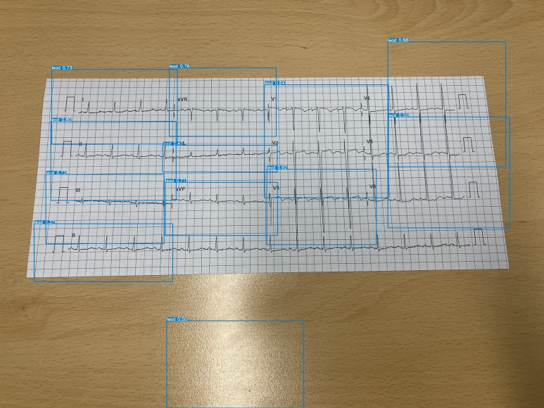
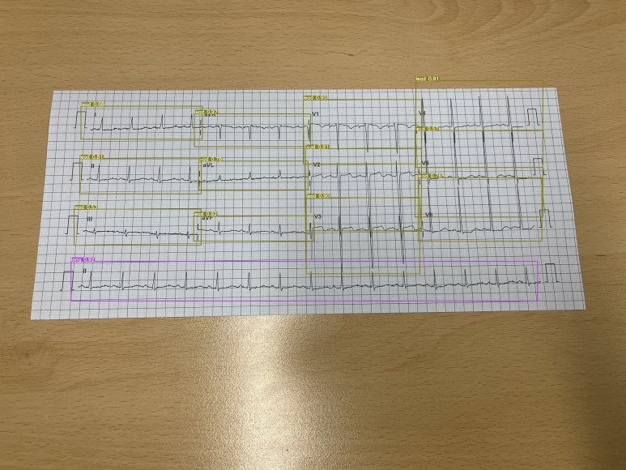
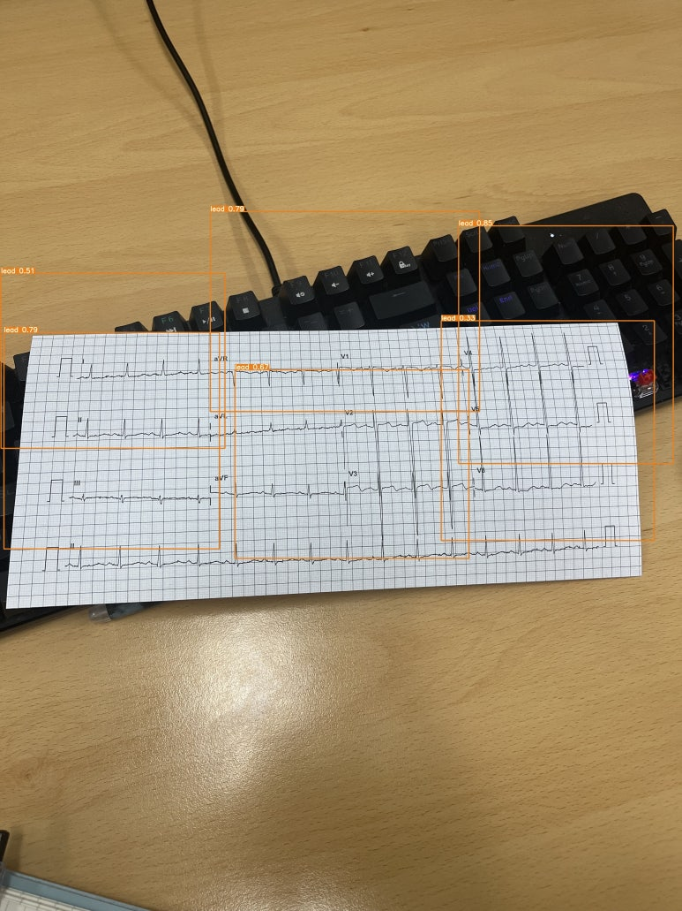
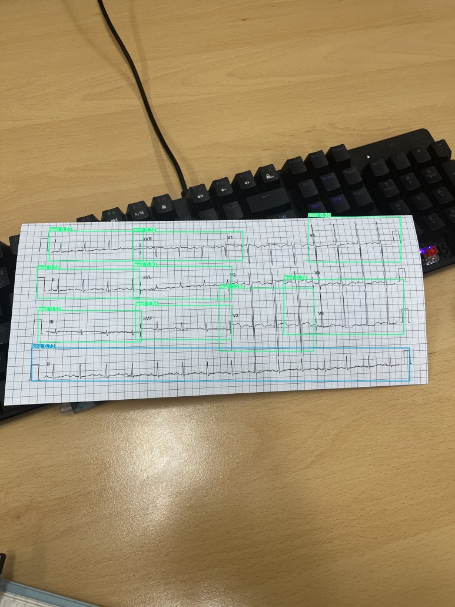
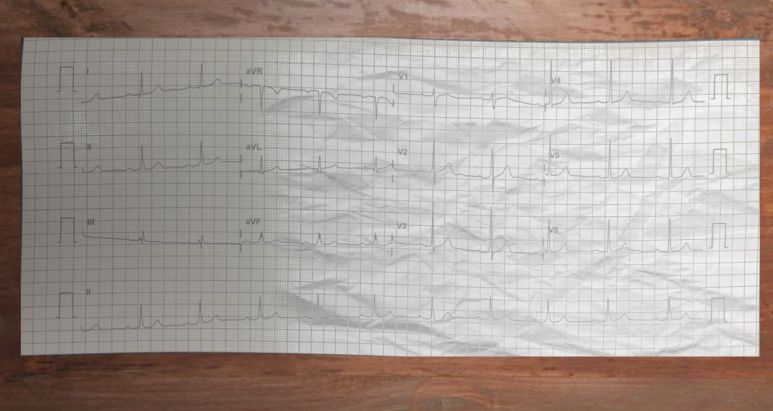
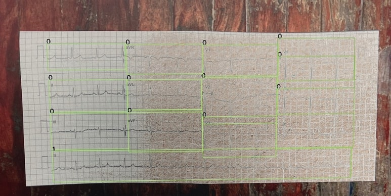
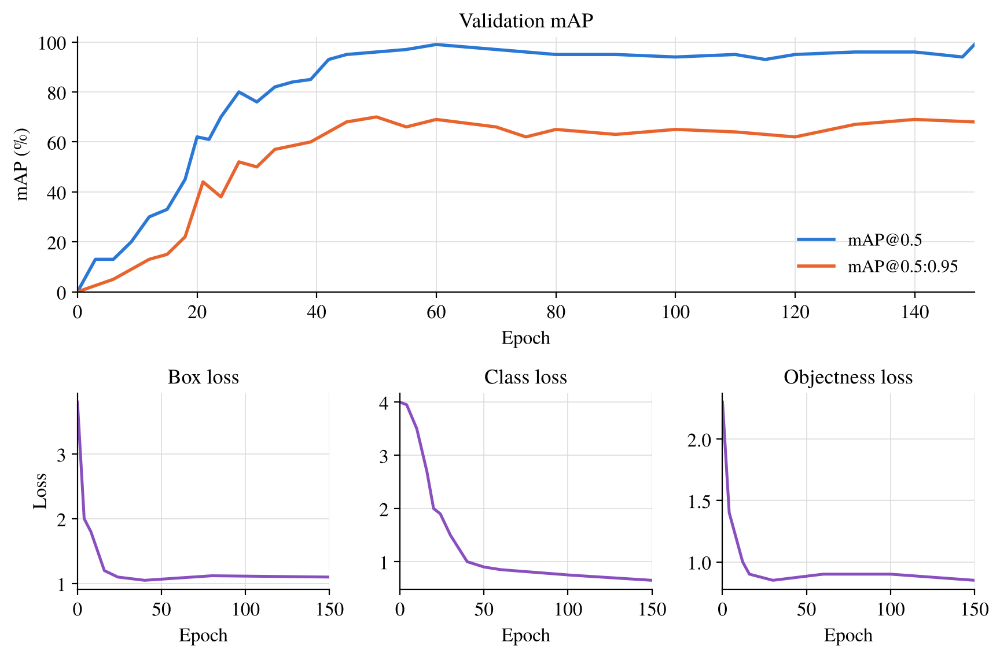
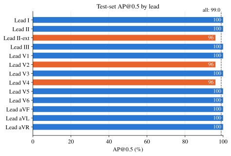

# 12-Lead ECG Dataset utils for Real-Time Lead ROI Detection using YOLO 

This repository provides resources and scripts to prepare and augment 12-lead ECG datasets for use with YOLOv7 models. The scripts include utilities for crawling background images, augmenting ECG data with various effects, extracting Regions of Interest (ROIs), and managing dataset organization.

## Examples

### 1. Lead Detection: Before and After

The following examples illustrate the bounding-box detection results
before and after refinement.

<table>
  <thead>
    <tr>
      <th width="50%">Before</th>
      <th width="50%">After</th>
    </tr>
  </thead>
  <tbody>
    <tr>
      <td align="center">
        
      </td>
      <td align="center">
        
      </td>
    </tr>
    <tr>
      <td align="center">
        
      </td>
      <td align="center">
        
      </td>
    </tr>
  </tbody>
</table>

  

### 2. ECG Images and Bounding-Box Annotations

Examples of ECG paper images and their associated lead-region annotations.

<table>
  <thead>
    <tr>
      <th width="50%">ECG Paper Image</th>
      <th width="50%">Bounding-Box Annotations</th>
    </tr>
  </thead>
  <tbody>
    <tr>
      <td align="center" valign="middle">
        
      </td>
      <td align="center" valign="middle">
        
      </td>
    </tr>
  </tbody>
</table>

### 3. Model Training and Evaluation

#### Training Progress

Validation mAP and training loss curves over 150 epochs.

  

#### Test-Set Performance by Lead

Test-set average precision at an IoU threshold of 0.5 (AP@0.5) for each ECG lead.

  

## Requirements
To run the scripts in this repository, install the following dependencies:

### Install Requirements
To install the dependencies on Ubuntu, use the following command:
pip install -r requirements.txt

Ensure you have Python and pip installed on your system. You can verify this with:
python --version
pip --version

---

## Contents

### crawling_bg.py
This script is used to download background images for data augmentation. It utilizes the icrawler library to fetch images from Google.

#### Function: crawl_image_data
def crawl_image_data(key_word: str, max_num: int, des_dir: str):
    from icrawler.builtin import GoogleImageCrawler
    google_crawler = GoogleImageCrawler(storage={'root_dir': des_dir})
    google_crawler.crawl(keyword=key_word, max_num=max_num)

- **Parameters:**
  - key_word: The keyword to search for background images.
  - max_num: Maximum number of images to download.
  - des_dir: Directory to save the downloaded images.

#### Usage Example:
python crawling.py --keyword 'topview table texture background' --max_num 100 --des_dir ./bg_noises  

Also, we'll need paper image for image augmentation

python crawling.py --keyword 'paper texture background' --max_num 100 --des_dir ./bg_papers 

### augmentation.py
This script provides functions for augmenting ECG images and labels by adding background noise, applying shadows, and introducing geometric distortions.

#### Global Variables:
- rectangles: List to store rectangle coordinates.
- start_point, end_point: Points for drawing rectangles.
- drawing, delete_mode: Flags for drawing and deletion modes.
- image, img_copy, img_with_text: Variables for the working image.

#### Key Functions:

##### 1. add_background_noise
Adds background noise to an image and adjusts bounding box labels accordingly.

- **Highlights:**
  - Pads the image with random borders.
  - Adds background noise using a provided background and paper image.
  - Adjusts bounding box coordinates in YOLO format.

##### 2. generate_spot_light_mask
Generates a spotlight effect mask with Gaussian decay.

- **Parameters:**
  - mask_size: Size of the mask.
  - position: Center of the spotlight.
  - max_brightness, min_brightness: Brightness range.
  - mode: Decay mode (Gaussian or linear).
  - speedup: Optimization flag.

##### 3. add_spot_light
Applies the spotlight effect to an image.

- **Parameters:**
  - image: Input image.
  - light_position: Center of the spotlight.
  - transparency: Blend ratio for the effect.

##### 4. add_bend_distortion
Applies bend distortion to an image using sinusoidal transformations.

#### Dataset Augmentation Workflow
The script processes images and labels, applying augmentations with background noise and other effects. The augmented data is saved in designated directories.

### roi.py
This script extracts Regions of Interest (ROIs) from images using a YOLOv7 model and saves them as individual image files along with their bounding box information.

#### Key Function: detect_and_save_rois
- Extracts ROIs from input images based on YOLOv7 detections.
- Saves ROIs as separate image files and bounding box information in YOLO format.
- Automatically organizes and sorts the leads based on classes and positions.

#### Usage:
Run the script with the following command:
python roi.py --weights [pt_file] --source [image_file]

#### Arguments:
- --weights: Path to the YOLOv7 model file (e.g., yolov7.pt).
- --source: Path to the image or folder of images for inference.

---

## Notes
- Ensure the icrawler, cv2, and torch libraries are installed before running the scripts.
- The augmentation.py script assumes images and labels follow the YOLO format.
- Background images and paper textures should be stored in bg_noises and bg_papers directories, respectively.
