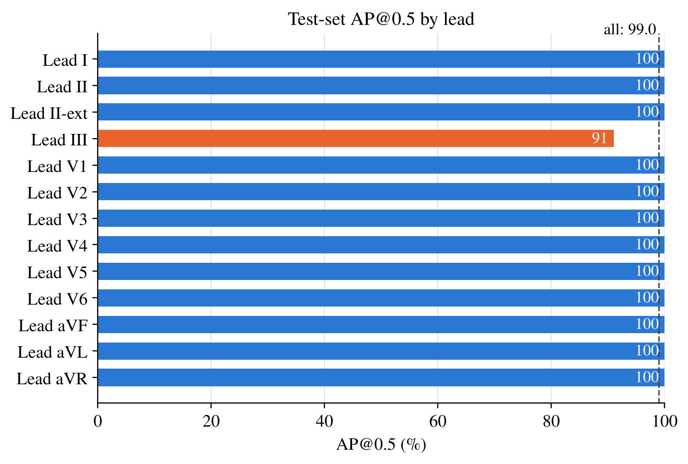

## Examples

### 1. Lead Detection: Before and After

The following examples illustrate the bounding-box detection results
before and after refinement.

<table>
  <thead>
    <tr>
      <th width="50%">Before</th>
      <th width="50%">After</th>
    </tr>
  </thead>
  <tbody>
    <tr>
      <td align="center">
        
      </td>
      <td align="center">
        
      </td>
    </tr>
    <tr>
      <td align="center">
        
      </td>
      <td align="center">
        
      </td>
    </tr>
  </tbody>
</table>

### 2. ECG Images and Bounding-Box Annotations

Examples of ECG paper images and their associated lead-region annotations.

<table>
  <thead>
    <tr>
      <th width="50%">ECG Paper Image</th>
      <th width="50%">Bounding-Box Annotations</th>
    </tr>
  </thead>
  <tbody>
    <tr>
      <td align="center" valign="middle">
        
      </td>
      <td align="center" valign="middle">
        
      </td>
    </tr>
  </tbody>
</table>

### 3. Model Training and Evaluation

#### Training Progress

Validation mAP and training loss curves over 150 epochs.

  

#### Test-Set Performance by Lead

Test-set average precision at an IoU threshold of 0.5 (AP@0.5) for each ECG lead.

  

